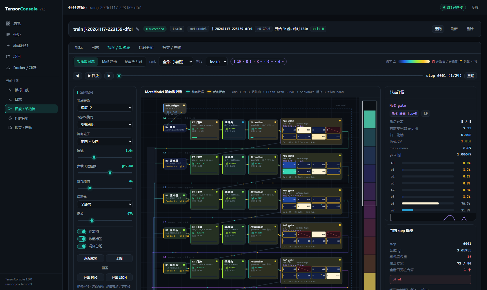
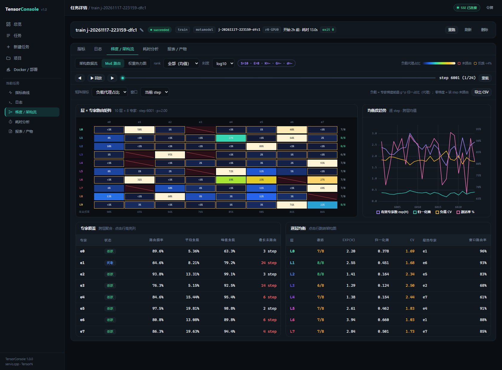
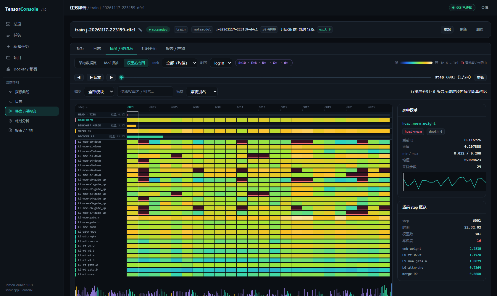

# TensorConsole

基于 **TensorN** C++ Backend 的 Train/Infer 平台可视化管理面板。单个 `tcd` 守护进程提供
任务编排（CMake 构建 / 训练 / 评测 / 生成 / Docker / systemd 部署）、全量 REST API、
SSE 实时事件流，以及 HTML5 面板；`tc` CLI 供 Agent 系统以报文/报表/流式方式交互；
`tc_probe.hpp`（C++）/ `tc_probe.py`（PyTorch）零依赖 SDK 供引擎内埋点。

设计文档见 [docs/DESIGN.md](docs/DESIGN.md)。

## 核心功能

- **梯度 / 架构流** — 逐 step、逐权重按 **输出→输入** 顺序采集 grad L2（`ENG_DUMP_GRAD`），
  并在同一数据源上提供三个联动视图（共享 step 回放 / rank 选择 / log-lin 刻度）：
  1. **架构数据流**：把 MetaModel 真实前向图渲染为可操纵节点图 ——
     `emb → [RT 门控 → 组路由 argmax → 分段 Flash-Attn → MoE top-K] × S`，各层输出
     `b_li` 汇入 **Birkhoff/Sinkhorn 双随机混合总线**，读出行 `R_li` 以凸组合生成下一层
     输入，末端 tied head。节点显示合成 |g|、步内能量占比、零梯度数；MoE 节点内嵌
     专家格（负载占比 / 路由激活 / 梯度三种编码），未路由专家以斜线标记、饥饿专家描琥珀边；
     前向数据与反向梯度以双色粒子沿边流动。左侧控制轨实时调节着色指标、专家格编码、
     流向/流速、负载代理指数 g^p、饥饿阈值、层聚焦、缩放、专家格/标签/总线开关，
     支持拖拽平移、滚轮缩放、小地图跳转、节点/专家检查器、PNG / JSON 导出。
  2. **MoE 路由**：层×专家负载/激活/梯度矩阵（当前 step / 窗口均值 / 激活频率）、
     均衡度趋势（有效专家数 exp(H)、归一化熵、负载 CV、激活率，双 Y 轴）、
     专家覆盖表（路由频率 / 峰值负载 / 最长连续未路由 / 死亡-饥饿-间歇-活跃状态）、
     逐层均衡表（点击跳转架构图对应层）、CSV 导出。
     **负载为代理指标**：专家梯度能量 `g^p` 归一占比；零梯度 = 该 step 无 token 路由到该专家
     （精确），真实 token 计数需引擎侧 dispatch 遥测。
  3. **权重热力图**：Canvas 热力图（log10 flux 色带）+ 波形条 + 零梯度清单，行按层分组、
     组头显示该层步内梯度能量占比，紧凑语义别名（`L9·moe·e0·gate_up`）/完整参数名切换。
  权重顺序由 `adapter::grad_order_template` 生成，运行时按实际观测到的参数名过滤
  （`order_observed`）。视图深链：`#job/<id>/grad/<arch|moe|heat>`。
- **全流程耗时分析** — 两条可插拔通路：
  1. 引擎 `ENG_PROF=1` 的 `[prof]` 算子/阶段耗时表（`profiler::from_eng_prof`）；
  2. Chrome Trace JSON（`POST /api/jobs/:id/profile` 上传，或 SDK `tc_probe::flush`
     自动写 `trace.json`），解析为火焰图（`profiler::from_chrome_trace`）。
- **Agent CLI** — `tc` 与服务器通信，直接返回 JSON 报文、Markdown/JSON 报表文件、
  CSV 指标/梯度、测试与调试输出；`--follow`/`events` 走 SSE 流式获取；`--wait` 阻塞至
  终态并以退出码反映任务结果。
- **多 GPU 并行** — `gpus=0,1,...` 每卡一个 rank 进程（`CUDA_VISIBLE_DEVICES` 隔离），
  `data_shard` 按 rank 自动偏移数据；逐 rank 采集 `grad_raw_r<i>.csv`，指标/梯度按
  (step, rank) 合并，面板可按 rank 过滤。
- **PyTorch 接入** — 注册 `kind=pytorch` 项目后，用 `python` 或 `ddp`（每卡一个 worker）启动
  训练脚本；tcd 注入 `TC_*` 环境与 `PYTHONPATH=sdk`，脚本两行接入 `sdk/tc_probe.py`
  即可获得逐权重梯度、自定义指标、Chrome Trace 火焰图与面板「停止」语义，
  数据走与 C++ 引擎相同的 metrics/grad/trace 通道并实时推送到面板。
- **全参数任务配置** — schema 驱动表单覆盖 MetaModel 训练全部参数（运行/数据/结构/
  优化/损失/精度/冻结/日志/诊断/多 GPU 共 10 组），以及 build/docker/deploy/custom
  任务参数；schema 由 `GET /api/projects/:id/schema?type=<train|eval|...>` 提供。

## 功能展示

实机截图（10 层 × 8 专家 MetaModel，24 step 梯度采集，step 6001）：

**架构数据流** — 前向图节点化：RT / 组路由 / Flash-Attn / MoE 专家格 / Sinkhorn 读出行，
左侧 Birkhoff 混合总线织带、双色流向粒子、右上小地图、右侧节点检查器与 step 概览
（合成 |g|、零梯度权重、激活专家 72/80、全窗口死亡专家 L4·e1）。



**MoE 路由** — 层×专家负载矩阵（斜线 = 未路由、琥珀边 = 饥饿）、均衡度双轴趋势、
专家覆盖与逐层均衡表；可见 e1 间歇路由（64.6%、最长 24 step 未路由）与 L2/L3 路由坍缩
（归一化熵 0.164 / 0.124，单专家占 89% / 95%）。



**权重热力图** — 按层分组的 301 权重 × 24 step 热力图，组头能量占比、紧凑别名、
零梯度红色刻痕、选中权重 sparkline 与 step 概览。



## 目录

```
src/        tcd 后端（api/jobs/store/events/monitor/adapter/profiler/process）
cli/tc.cpp  tc CLI（Boost.Asio 同步 HTTP + SSE）
sdk/        tc_probe.hpp（C++17）/ tc_probe.py（PyTorch）零依赖探针 SDK
web/        前端 SPA（vanilla JS + uPlot + Canvas）
tests/      smoke.py 端到端测试（stdlib only）
docs/       DESIGN.md + img/ 功能展示截图
.github/    CI / Release 工作流
data/       运行时数据（file-as-database，见下）
```

## 构建

依赖：C++20 编译器、CMake ≥ 3.18、Boost（Asio，header-only 即可）、
[servic.cpp](https://github.com/yauntyour/servic.cpp)（本地 clone 或自动 FetchContent）。

Windows（MSYS2 ucrt64）：

```bash
export PATH="/d/x64/msys2/ucrt64/bin:$PATH"
cmake -S . -B build -G Ninja -DSERVIC_ROOT=D:/Developments/CXX/servic.cpp
cmake --build build -j 8
```

Linux：

```bash
cmake -S . -B build -DCMAKE_BUILD_TYPE=Release
cmake --build build -j
```

产物：`build/tcd`（守护进程）、`build/tc`（CLI）。
注意：Windows 下 `tcd.exe` 运行时被锁定，重新链接前需先停止守护进程。

### 依赖与 CI 友好配置

- Boost 头文件（Asio）为必需：ubuntu `apt install libboost-dev`、macos `brew install boost`、
  windows `vcpkg install boost-asio:x64-windows`（配合 vcpkg toolchain），或 `-DBOOST_ROOT=<dir>`。
- servic.cpp 解析顺序：`-DSERVIC_ROOT` > 环境变量 `SERVIC_ROOT` > 同级 `../servic.cpp` >
  FetchContent；`-DSERVIC_GIT_TAG=<tag|sha>` 可 pin 引用，离线构建用
  `-DFETCHCONTENT_SOURCE_DIR_SERVIC=<dir>` 预置源码。
- `TC_STATIC_CRT=ON`（默认，仅 MSVC 生效）静态链接 CRT，release exe 不依赖 VCRedist。
- 本地打包：`cmake --build build --target package` →
  `build/tensorconsole-<ver>-<OS>-<arch>.zip|tar.gz`。包内根目录即
  `tcd / tc / web/ / sdk/ / docs/ / README.md`，解压后直接 `./tcd` 即可以默认 `--web ./web` 运行。

### GitHub 自动化 Release

[.github/workflows/release.yml](.github/workflows/release.yml)：push `main` 与 PR 触发三平台
（linux-x86_64 / macos-arm64 / windows-x86_64）Release 构建、二进制自检（`tcd --help`、
启动后 `curl /api/health`）与 CPack 打包上传 artifact；push tag `v*` 时汇总三平台产物并创建
GitHub Release（自动生成 notes，tag 含 `-` 视为 prerelease）。`workflow_dispatch` 可手动触发；
仓库 variable `SERVIC_GIT_TAG` 可统一 pin servic.cpp 引用。

## 运行

```bash
./build/tcd --port 8686 --data data --web web
# 面板: http://127.0.0.1:8686/
```

| 参数/环境变量 | 说明 |
|---|---|
| `--bind` / `TCD_BIND` | 监听地址，默认 127.0.0.1 |
| `--port` / `TCD_PORT` | 端口，默认 8686 |
| `--token` / `TCD_TOKEN` | Bearer token；**非 loopback 监听必须设置** |
| `--data` / `TCD_DATA` | 数据目录 |
| `--web` / `TCD_WEB` | 静态前端目录 |

### 数据布局（file-as-database）

```
data/projects.json
data/jobs/<id>/
  job.json          任务记录（spec/ranks/status/exit_code/env/artifacts）
  stdout.log        合并输出（逐 rank 前缀）
  metrics.jsonl     {step,t,rank,v:{ce,aux,lr,grad_norm,tps,pool_*,...}}
  grad_raw_r<i>.csv 引擎 ENG_DUMP_GRAD 原始输出
  grad.jsonl        按 manifest 排序后的 {step,rank,t,norms:[[name,l2],...]}
  grad_order.json   输出→输入权重顺序
  profile.json      eng_prof 汇总或 chrome trace 解析结果
  trace.json        SDK 上传/写入的 Chrome Trace
  report.md/json    报表
```

## CLI（Agent 接口）

```bash
tc health | system | gpus
tc projects list | projects add --root DIR [--id ID] [--name N] [--kind metamodel|pytorch] | projects rm <id>
tc schema <project> --type train
tc train <project> -p steps=2000 -p d_model=512 -p gpus=0,1 -p grad=true --wait
tc train pyproj -p script=train.py -p args="--steps 1000" -p gpus=0,1 -p launcher=ddp --wait
tc submit <project> eval -p ckpt=checkpoints/run.pt -p windows=32
tc build <project> --targets train --arch 120 --wait
tc jobs [--status running] | job <id> | stop <id>
tc logs <id> --follow                 # SSE 流式日志
tc metrics <id> --csv > metrics.csv
tc grad order <id> | grad <id> --csv
tc profile <id> [--upload trace.json]
tc report <id> --out report.md        # Markdown 报表（--format json 可选）
tc artifacts <id>
tc docker ps | images
tc events --count 10                  # 原始 SSE 事件流
```

全局：`--server URL`、`--token T`、`--json`；环境变量 `TC_SERVER`/`TC_TOKEN`。
`--wait` 将报表打印到 stderr、任务 JSON 打印到 stdout，进程退出码 = 任务退出码，
便于 Agent 直接管道消费。

## REST API（供外部监控软件）

| 方法 | 路径 | 说明 |
|---|---|---|
| GET | `/api/health` | 健康检查（免鉴权） |
| GET | `/api/system` `/api/gpus?history=0\|1` | 主机/GPU 采样与历史（nvidia-smi） |
| GET/POST | `/api/projects` | 项目列表/注册 |
| GET/DELETE | `/api/projects/:id` | 项目详情/删除 |
| GET | `/api/projects/:id/schema?type=train` | 任务参数 schema |
| GET/POST | `/api/jobs` | 任务列表（status/project/type/limit 过滤）/提交 |
| GET/DELETE | `/api/jobs/:id` | 任务详情/删除（运行中返回 409） |
| POST | `/api/jobs/:id/stop` | 停止（写 `<out>.STOP`，15s 后强杀） |
| GET | `/api/jobs/:id/logs?offset&limit` | 日志尾部 |
| GET | `/api/jobs/:id/metrics?keys&from&to` | 指标（按 step,rank 合并） |
| GET | `/api/jobs/:id/grad/order` `/grad?step&rank&from&to&limit` | 梯度顺序/数据 |
| GET/POST | `/api/jobs/:id/profile` | 耗时分析/上传 Chrome Trace |
| GET | `/api/jobs/:id/report?format=md\|json` | 报表 |
| GET | `/api/jobs/:id/artifacts[/:name]` | 产物清单/下载（防路径穿越） |
| GET | `/api/docker/ps` `/api/docker/images` | Docker 状态 |
| POST | `/api/deploy` | systemd/脚本部署任务 |
| GET | `/api/events?topics=job,gpu,metrics` | SSE 实时流 |

鉴权：`Authorization: Bearer <token>` 或 `?token=`（SSE）。loopback 默认免鉴权。

SSE 事件：`hello`、`gpu`、`heartbeat`（2s）、`job.status`、`job.log`、`metrics`、
`grad.step`、`prof.ready`。

## SDK 埋点（tc_probe.hpp / tc_probe.py）

三级探针，按侵入性递增：

- **L0**：引擎已有输出（`ENG_DUMP_GRAD` CSV、`<out>_log.csv`、stdout step/[prof] 行）
  由 tcd 自动 tail 解析，无需改代码。
- **L1**：引擎链接 header-only SDK，tcd 注入 `TC_JOB_ID/TC_JOB_DIR/TC_RANK/TC_SERVER/TC_TOKEN`：

```cpp
#include "tc_probe.hpp"
tc::Probe probe;                       // TC_JOB_DIR 存在时自动启用
probe.grad(step, "decoder_layers.0.attn.qkv.weight", l2);
probe.metrics(step, {{"ce", ce}, {"tps", tps}});
{
    TC_PROBE_SCOPE(probe, "attention");   // 计时 span → trace.json
    ...
}
probe.flush();                         // 或析构时自动 flush
```

- **L2**：任意进程 `POST /api/jobs/:id/profile`（Chrome Trace）或写文件到 job 目录。

PyTorch 版本位于 [sdk/tc_probe.py](sdk/tc_probe.py)（纯标准库，`torch` 可选）：

```python
from tc_probe import Probe

probe = Probe()                     # TC_JOB_DIR 存在时启用，否则全部 no-op
probe.watch(model)                  # 声明参数顺序（默认 reversed(named_parameters)）

for step, batch in enumerate(loader):
    loss = model(**batch).loss
    loss.backward()
    probe.step(step)                # 读取 p.grad L2 → 梯度示波器
    probe.metrics(step, {"loss": loss, "lr": lr})
    optimizer.step()
    optimizer.zero_grad(set_to_none=True)
    if probe.should_stop():         # 面板「停止」写 <out>.STOP
        break

with probe.scope("forward"):        # 耗时 span → trace.json 火焰图
    out = model(x)
```

## PyTorch 接入

1. 注册项目（root 为含训练脚本的仓库根）：`tc projects add --root D:/ML/mygpt --id mygpt --kind pytorch`
2. 提交训练：

```bash
# 单卡
tc train mygpt -p script=train.py -p args="--steps 2000 --batch 8" --wait
# 多卡 DDP（每卡一个 worker，注入 torchrun 兼容的 RANK/WORLD_SIZE/LOCAL_RANK）
tc train mygpt -p script=train.py -p launcher=ddp -p gpus=0,1 --wait
# 环境变量与自定义 Python
tc train mygpt -p python=.venv/Scripts/python.exe -p env="WANDB_MODE=offline;OMP_NUM_THREADS=4"
```

tcd 为训练进程注入：

| 变量 | 说明 |
|---|---|
| `TC_JOB_ID` / `TC_JOB_DIR` / `TC_RANK` | 任务标识与探针落盘目录（SDK 依据 `LOCAL_RANK` 覆盖 rank） |
| `TC_STOP_FILE` | 面板停止时写入的 STOP 文件，`probe.should_stop()` 轮询 |
| `TC_SERVER` / `TC_TOKEN` | tcd 地址与鉴权（脚本内可自行走 REST） |
| `PYTHONPATH` | 追加 `sdk/`，脚本直接 `from tc_probe import Probe`（`TCD_SDK_DIR` 可覆盖定位） |
| `CUDA_VISIBLE_DEVICES` / `PYTHONUNBUFFERED` | GPU 可见性与实时日志 |

- 未使用 SDK 时仍有实时日志、退出码与「停止」（15s 后强杀进程组）；使用 SDK 后
  指标与梯度实时呈现在现有 tab 中，trace 在任务结束时生成火焰图，无需额外适配。
- `kind=python` 与 `kind=pytorch` 等价。eval/generate/test 不单独编排，可用
  `custom` 类型执行任意脚本，或在训练脚本内实现。
- SDK 写入格式：`metrics.jsonl`（`src=probe`，tcd 直接转发 SSE）、
  `grad_raw_r<rank>.csv`、`grad_order.json`（tcd 优先采用 SDK 声明顺序）、
  `trace.json`（`ddp` 时其他 rank 写 `trace_r<rank>.json`，tcd 合并为一张火焰图）。

## MetaModel 集成约定

- 训练二进制 `build/train.exe`，评测 `build/eval_ce.exe`，生成 `build/generate.exe`，
  测试 `gradcheck/flash_test/birkhoff_test/fwd_test/bench_gemm`。
- `ENG_DUMP_GRAD=<csv>` 逐 step 逐权重输出 `step,name,grad_l2`；
  `ENG_PROF=1` 输出 `[prof]` 耗时表；`ENG_UNBUF=1` 保证实时 tail。
- 停止：面板写 `<out>.STOP`，引擎优雅退出；超时强杀。
- 断点/日志：`checkpoints/<run>/<run>.pt|_best.pt|_log.csv|_config.json`。
- 数据集缺省自动使用 `datasets/cache/mix_bil3b_mini_{train,val}.bin`。

## 测试

```bash
python tests/smoke.py             # 需 tcd 运行中 + MetaModel 已构建
# 24 项检查：health/schema/train/metrics/grad 顺序与唯一性/profile/
# chrome trace/报表/产物/stop 语义/双 rank 并行
python tests/tc_probe_selftest.py # 探针 SDK 契约自测（stdlib；torch 可选）
# 19 项检查：metrics/grad/order/trace/stop 文件格式、rank 检测、真实 torch 梯度
```

## 前端

- 总览：主机（CPU / 内存）、GPU 集群（跨卡平均利用率、显存合计、总功耗、峰值温度）、
  单卡明细三组分离，各配趋势曲线（SSE 驱动，2s 刷新）。
- 任务：列表、状态徽章、详情页五个 tab —— 指标（uPlot 多序列分 rank）、日志（流式）、
  梯度 / 架构流（架构数据流节点图 / MoE 路由分析 / 权重热力图，共享 step 回放与 rank）、
  耗时（火焰图/算子条形图/表格/trace 上传）、报表（Markdown 渲染 + 产物下载）。
  URL 深链：`#overview`、`#jobs`、`#job/<id>/<tab>[/<grad 子视图>]`，可直接分享/截图。
- 新建任务：schema 驱动全参数表单（train/eval/generate/test/build/docker/deploy/custom）。
- Docker：容器/镜像列表、部署任务提交。